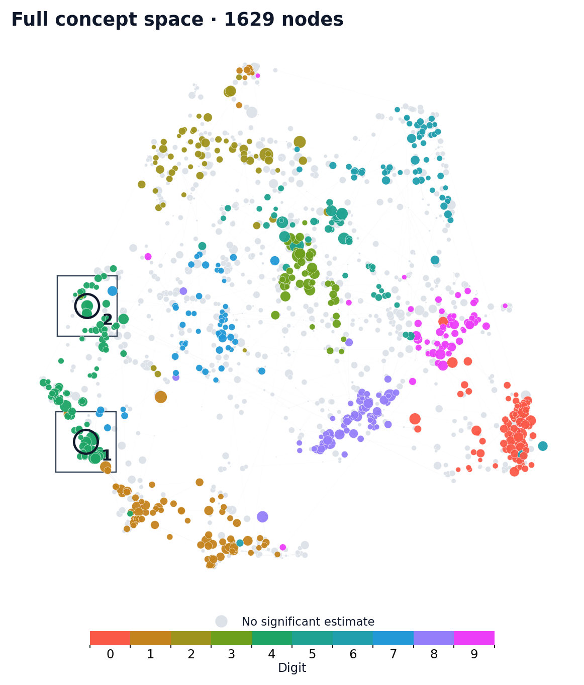
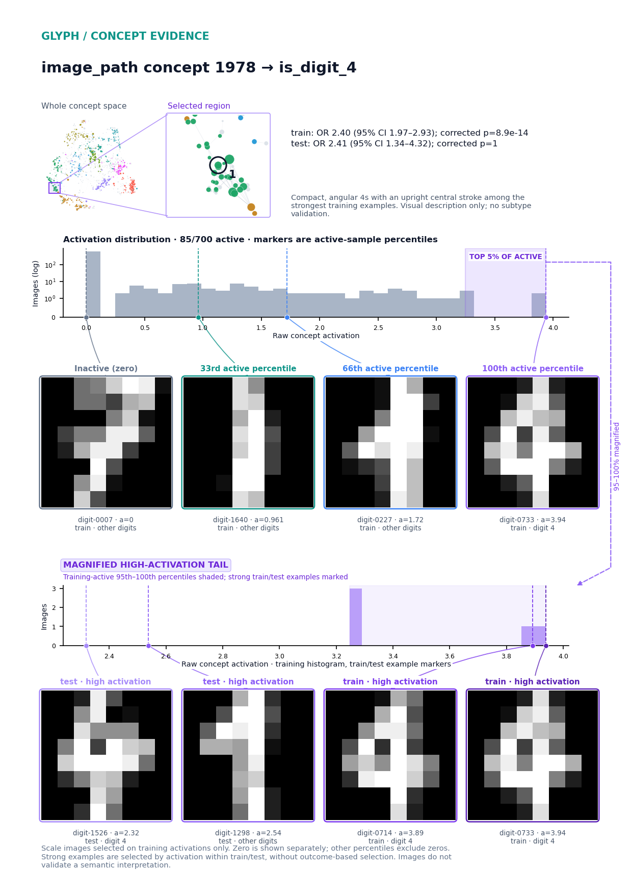
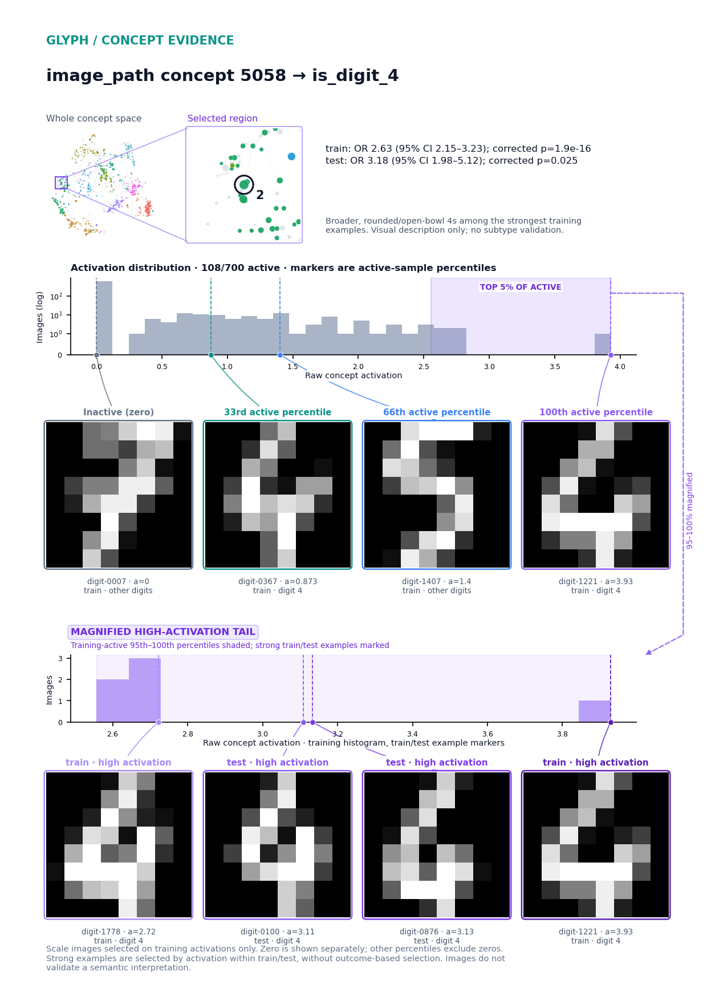

# Glyph + DINOv3: handwritten digits

680 significant associations · 1629 concepts mapped.
24/545 evaluable hits reproduce in test; 135 discovery hits lack evaluable comparison estimates.

train 700 / val 150 / test 150.
Reconstruction R²: validation 0.868; test 0.864 · k=64.
Test probe AUC: input vectors 0.996; full dictionary 1.000.

**Concept space.** All training-alive concepts learned from public DINOv3 digit embeddings. Color: strongest significant outcome. Node area is proportional to activation prevalence, with a tiny visibility floor and a common density adjustment. Missing prevalences use a uniform small marker. Lines show saved correlations, with at most eight per concept. Both OR directions; Bonferroni-corrected p < 0.05.

**image_path concept 1978 → is_digit_4.** train: OR 2.40 (95% CI 1.97–2.93); corrected p=8.9e-14.
test: OR 2.41 (95% CI 1.34–4.32); corrected p=1.
Compact, angular 4s with an upright central stroke among the strongest training examples. Visual description only; no subtype validation.

**image_path concept 5058 → is_digit_4.** train: OR 2.63 (95% CI 2.15–3.23); corrected p=1.9e-16.
test: OR 3.18 (95% CI 1.98–5.12); corrected p=0.025.
Broader, rounded/open-bowl 4s among the strongest training examples. Visual description only; no subtype validation.

Style descriptions are unvalidated training-image observations.

*Public UCI optical digits via sklearn.load_digits. Probe AUC shown is digit 0 versus rest; all ten outcome probes are saved. Associations are unadjusted. No automated interpretation pipeline or literature comparison was run.*
