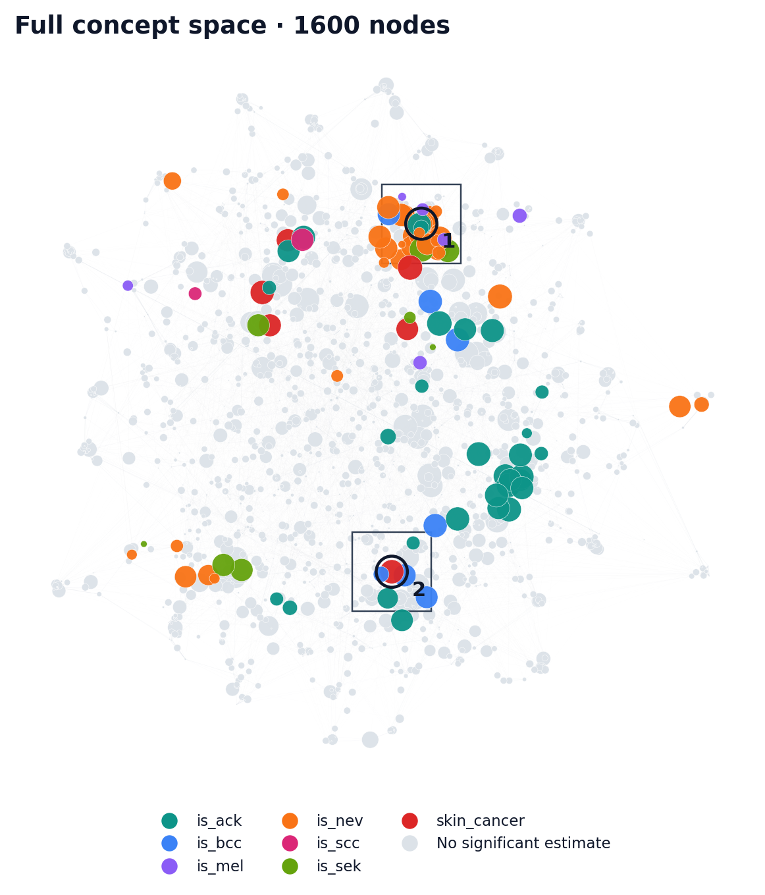
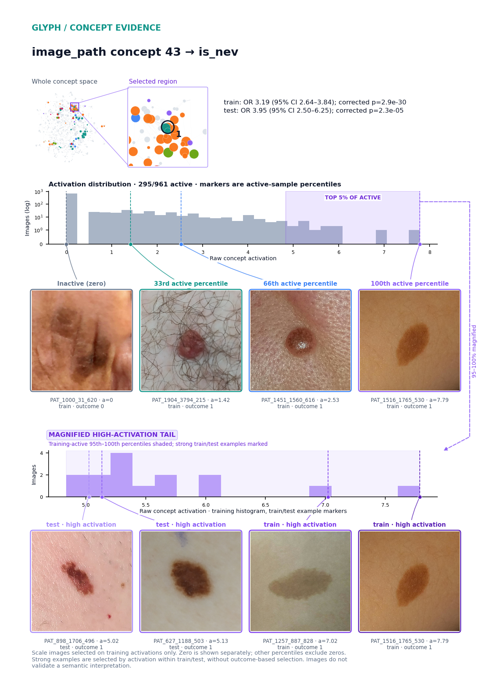
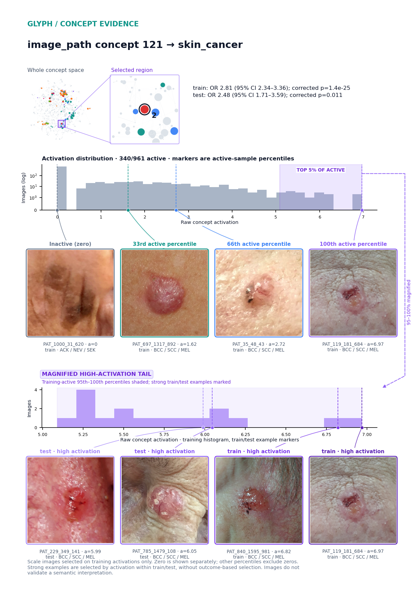
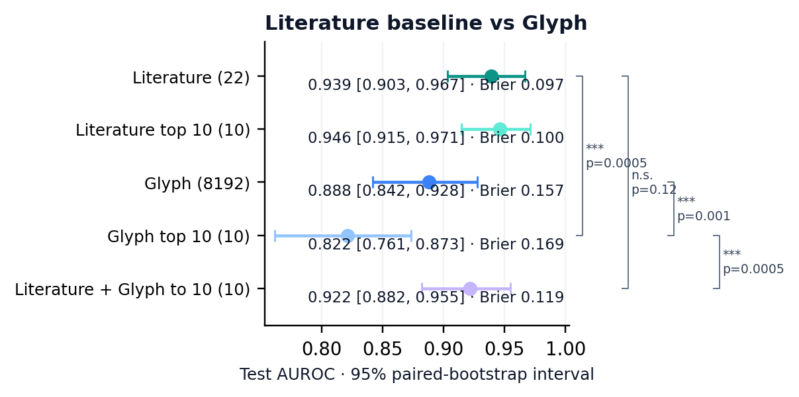

# Glyph + DINOv3: smartphone skin-lesion diagnosis

164 significant associations · 1600 concepts mapped.
17/138 evaluable hits reproduce in test; 26 discovery hits lack evaluable comparison estimates.

train 961 / val 206 / test 206.
Reconstruction R²: validation 0.757; test 0.759 · k=80 · below 0.85 target.
Test probe AUC: input vectors 0.893; full dictionary 0.884.

**Concept space.** PAD-UFES-20: 1,373 patients, one original photograph each, seven diagnostic outcomes. Color: strongest significant outcome. Node area is proportional to activation prevalence, with a tiny visibility floor and a common density adjustment. Missing prevalences use a uniform small marker. Lines show saved correlations, with at most eight per concept. Both OR directions; Bonferroni-corrected p < 0.05.

**image_path concept 43 → is_nev.** train: OR 3.19 (95% CI 2.64–3.84); corrected p=2.9e-30.
test: OR 3.95 (95% CI 2.50–6.25); corrected p=2.3e-05.

**image_path concept 121 → skin_cancer.** train: OR 2.81 (95% CI 2.34–3.36); corrected p=1.4e-25.
test: OR 2.48 (95% CI 1.71–3.59); corrected p=0.011.

**Literature baseline comparison.**  Capped combination: ΔAUC -0.0170 (95% CI -0.0388 to +0.0044), paired p=0.122 (exploratory, unadjusted).

The capped combined model pools literature and Glyph candidates and selects 10 total predictors using their training-only ranking; either or both sources may be selected.

- Literature: AUC 0.939 (95% CI 0.903–0.967).
- Literature top 10: AUC 0.946 (95% CI 0.915–0.971).
- Glyph: AUC 0.888 (95% CI 0.842–0.928).
- Glyph top 10: AUC 0.822 (95% CI 0.761–0.873).
- Literature + Glyph to 10: AUC 0.922 (95% CI 0.882–0.955).
- Literature vs Glyph top 10: ***, paired p=0.0005 (exploratory, unadjusted).
- Literature vs Literature + Glyph to 10: n.s., paired p=0.12 (exploratory, unadjusted).
- Glyph vs Glyph top 10: ***, paired p=0.001 (exploratory, unadjusted).
- Glyph top 10 vs Literature + Glyph to 10: ***, paired p=0.0005 (exploratory, unadjusted).

Literature markers: age, itch, bleed, hurt, grew, changed, elevation, site_abdomen, site_arm, site_back, site_chest, site_ear, site_face, site_foot, site_forearm, site_hand, site_lip, site_neck, site_nose, site_scalp, site_shin, site_thigh. Prediction uses 22 literature markers, 8192 Glyph concepts and their combination. The forest panel shows up to six training-ranked markers per source; all matched estimates and reproduction counts are retained. Individual associations use 22 versus 22, with a separate 44-test family at corrected p<0.05. The full discovery analysis retains 5642 tests; these reproduction denominators differ.

Sources: [Pacheco and Krohling, The impact of patient clinical information on automated skin cancer detection, Computers in Biology and Medicine 2020](https://arxiv.org/html/1909.12912).
Literature search: 1 unique retrieved papers; 1 titles screened; 1 selected papers yielding 22 markers. See the saved query log for search limits and coverage.
Eight clinical fields encoded as 22 numerical predictors; top-ten arms rank encoded predictors. Clinical coefficients are fitted on the new training split, not copied from a published classifier. Contemporaneous diagnosis rather than prognosis; no external validation. Clinical and histological reference standards differ among non-cancer cases. No automated semantic interpretation or confounder adjustment.
AUC intervals condition on frozen models and use 2000 paired subject-bootstrap resamples; a perfect empirical ranking yields a degenerate interval.

Automated interpretation was not run.

*Patient-held-out diagnostic benchmark, not prognosis or external validation. The clinical baseline refits eight published inputs; it is not the historical fitted classifier. Some non-cancer labels use clinical consensus. Melanoma has only five test examples. Automated interpretation and confounder adjustment were not run. Images: Pacheco et al., PAD-UFES-20 v1, doi:10.17632/zr7vgbcyr2.1, CC BY 4.0; resized for display.*
