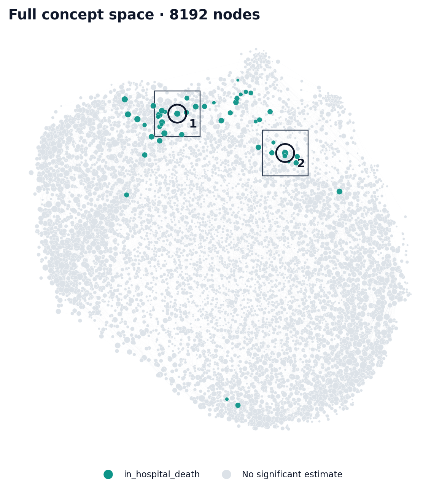
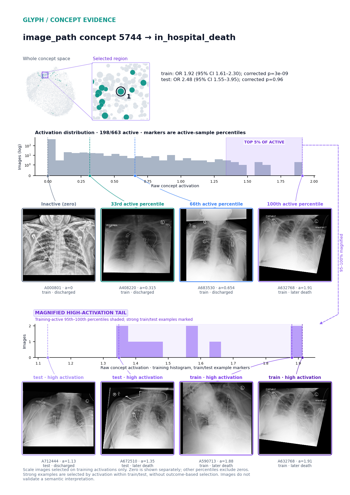
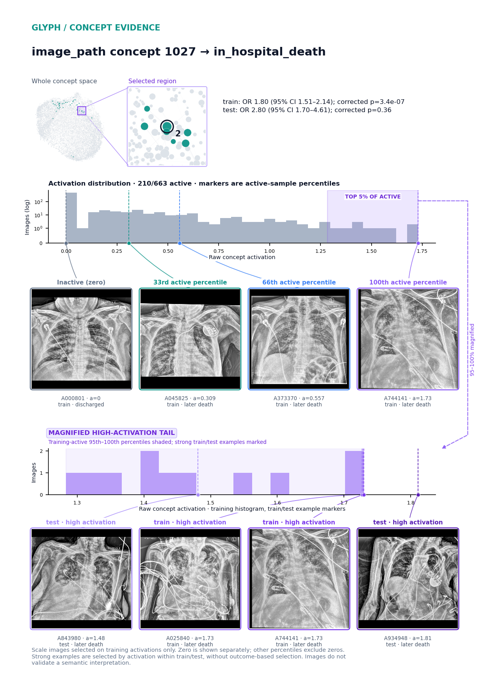
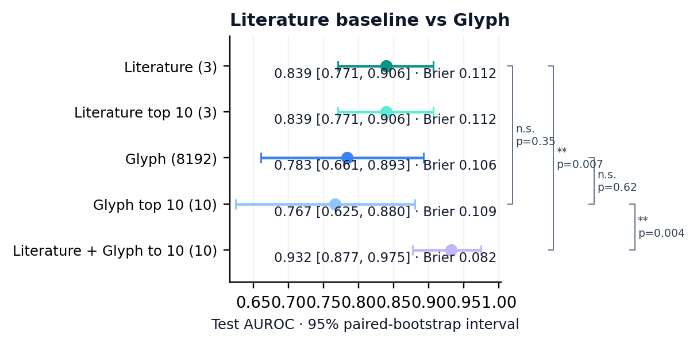

# Glyph + DINOv3: chest X-ray mortality

46 significant associations · 8192 concepts mapped.
1/31 evaluable hits reproduce in test; 15 discovery hits lack evaluable comparison estimates.

train 663 (115 events) / val 142 (24 events) / test 143 (25 events).
Reconstruction R²: validation 0.905; test 0.902 · k=768.
Test probe AUC: input vectors 0.768; full dictionary 0.781.

**Concept space.** TCIA COVID-19-NY-SBU (10.7937/TCIA.BBAG-2923); complete training-alive concept space. Color: strongest significant outcome. Node area is proportional to activation prevalence, with a tiny visibility floor and a common density adjustment. Missing prevalences use a uniform small marker. Lines show saved correlations, with at most eight per concept. Both OR directions; Bonferroni-corrected p < 0.05.

**image_path concept 5744 → in_hospital_death.** train: OR 1.92 (95% CI 1.61–2.30); corrected p=3e-09.
test: OR 2.48 (95% CI 1.55–3.95); corrected p=0.96.

**image_path concept 1027 → in_hospital_death.** train: OR 1.80 (95% CI 1.51–2.14); corrected p=3.4e-07.
test: OR 2.80 (95% CI 1.70–4.61); corrected p=0.36.

**Literature baseline comparison.**  Capped combination: ΔAUC +0.0929 (95% CI +0.0311 to +0.1619), paired p=0.00699 (exploratory, unadjusted).

- Literature: AUC 0.839 (95% CI 0.771–0.906).
- Literature top 10: AUC 0.839 (95% CI 0.771–0.906).
- Glyph: AUC 0.783 (95% CI 0.661–0.893).
- Glyph top 10: AUC 0.767 (95% CI 0.625–0.880).
- Literature + Glyph to 10: AUC 0.932 (95% CI 0.877–0.975).
- Literature vs Glyph top 10: n.s., paired p=0.35 (exploratory, unadjusted).
- Literature vs Literature + Glyph to 10: **, paired p=0.007 (exploratory, unadjusted).
- Glyph vs Glyph top 10: n.s., paired p=0.62 (exploratory, unadjusted).
- Glyph top 10 vs Literature + Glyph to 10: **, paired p=0.004 (exploratory, unadjusted).

Literature markers: age_60_74, age_75_plus, male. Prediction uses 3 literature markers, 8192 Glyph concepts and their combination. Individual associations use 3 versus 3, with a separate 6-test family at corrected p<0.05. The full discovery analysis retains 6878 tests; these reproduction denominators differ.

Sources: [Williamson et al., Factors associated with COVID-19-related death using OpenSAFELY, Nature 2020](https://pmc.ncbi.nlm.nih.gov/articles/PMC7611074/).
Literature search: 1 unique retrieved papers; 1 titles screened; 1 selected papers yielding 3 markers. See the saved query log for search limits and coverage.
One patient per observation; internal validation at one site. Admission-period images precede the hospital-day-two mortality landmark. Age bands and sex form a simplified literature baseline, not the published model. No LLM interpretation or confounder adjustment.
AUC intervals condition on frozen models and use 1000 paired subject-bootstrap resamples; a perfect empirical ranking yields a degenerate interval.

Interpretation not requested; cached interpretations are shown when available.

*One patient per observation; internal validation at one site. Admission-period images precede the hospital-day-two mortality landmark. Age bands and sex form a simplified literature baseline, not the published model. No LLM interpretation or confounder adjustment.*
